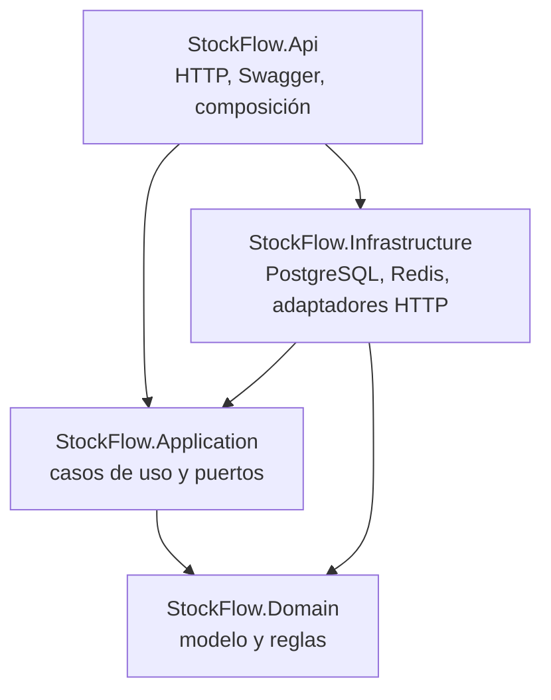

# Arquitectura de StockFlow

StockFlow es un proyecto de aprendizaje sin interfaz. Se explora con Swagger UI y se prueba desde Postman. La base usa un monolito modular con estilo Clean Architecture: una API desplegable, una base PostgreSQL, Redis y adaptadores de Infrastructure para servicios externos.

## Proyectos y dependencias

`StockFlow.Api` referencia `StockFlow.Infrastructure` para registrar los adaptadores al iniciar la app. Application depende de interfaces propias. Domain no tiene dependencias de proyectos ni de infraestructura.

## Responsabilidades

| Proyecto | Contiene | No contiene |
| --- | --- | --- |
| `StockFlow.Domain` | Entidades, value objects, reglas y errores de dominio | HTTP, EF Core, SQL, Redis, SDKs de proveedores |
| `StockFlow.Application` | Casos de uso, puertos, orquestación y DTOs de aplicación | Controladores, detalles del proveedor de base, implementaciones HTTP |
| `StockFlow.Infrastructure` | DbContext/configuraciones/migraciones EF Core, adaptadores SQL, Redis y clientes externos | Comportamiento de endpoints o políticas de negocio |
| `StockFlow.Api` | Controladores, validación, ProblemDetails, Swagger, registro de dependencias | Reglas de negocio de pedidos/stock o consultas SQL |

El código inicial incluye un flujo vertical pequeño de cotización: Controller → caso de uso de Application → abstracciones de caché/proveedor → Redis o Frankfurter. PostgreSQL está conectado a través de EF Core y `IDbConnectionFactory`; las tablas y migraciones se incorporan en la etapa de persistencia.

## Datos y consistencia

- PostgreSQL es la fuente de verdad para productos, pedidos e inventario.
- Usa EF Core para lecturas y escrituras comunes. Usa la factoría Npgsql para practicar SQL explícito cuando una escritura condicional o una transacción aporte valor.
- Una reserva de stock debe actualizar el saldo, insertar el movimiento y pedido, y guardar el mensaje outbox en una sola transacción. Verifica las filas afectadas en los decrementos condicionales.
- Cachea lecturas del catálogo y cotizaciones con TTL explícito. Nunca uses stock cacheado para aprobar pedidos. Invalida la caché del catálogo después del commit.
- Mantén llamadas HTTP fuera de transacciones SQL. Si el flujo necesita una entrega externa confiable, guarda el evento outbox y procésalo en segundo plano.
- Cambia el esquema con migraciones. Aplícalas explícitamente durante la configuración o el despliegue; no al iniciar la API.

## Flujo inicial de una request

1. `CurrencyRatesController` valida la ruta HTTP y llama a `GetCurrencyRateHandler`.
2. El handler normaliza los códigos y consulta `ICacheStore`.
3. Ante un cache miss, llama a `IExchangeRateProvider`, implementado por el adaptador HTTP de Frankfurter.
4. El handler guarda el resultado en Redis durante 12 horas y devuelve un DTO de Application.
5. `GlobalExceptionHandler` registra la excepción y convierte fallos upstream en un `502 ProblemDetails` seguro.

## Decisiones transversales

- Framework: `net10.0`; `global.json` fija la línea del SDK.
- Las versiones de paquetes se administran centralmente en `Directory.Packages.props`.
- Swagger UI se habilita en Development. Postman es la colección portátil de requests.
- PostgreSQL y Redis locales se ejecutan con `compose.yaml`.
- Las credenciales de contenedor son solo para desarrollo local. Usa variables de entorno o user secrets fuera de ese entorno.

## Referencias

- [Política de soporte de .NET](https://dotnet.microsoft.com/en-us/platform/support/policy)
- [Versiones y soporte de EF Core](https://learn.microsoft.com/en-us/ef/core/what-is-new/)
- [API Frankfurter](https://frankfurter.dev/)
