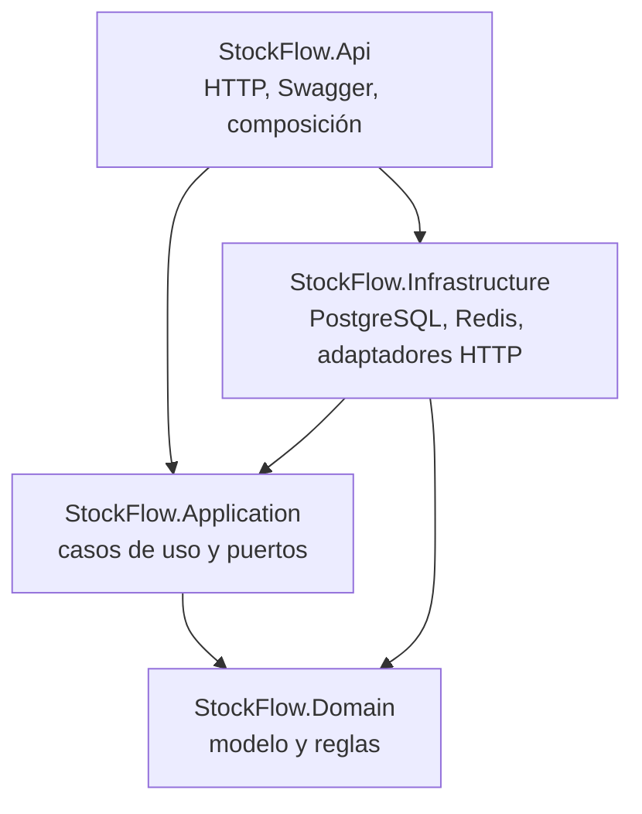

# Arquitectura de StockFlow

StockFlow es un proyecto de aprendizaje sin interfaz. Se explora con Swagger UI y se prueba desde Postman. La base usa un monolito modular con estilo Clean Architecture: una API desplegable, una base PostgreSQL, Redis y adaptadores de Infrastructure para servicios externos.

## Proyectos y dependencias

`StockFlow.Api` referencia `StockFlow.Infrastructure` para registrar los adaptadores al iniciar la app. Application depende de interfaces propias. Domain no tiene dependencias de proyectos ni de infraestructura.

## Responsabilidades

| Proyecto | Contiene | No contiene |
| --- | --- | --- |
| `StockFlow.Domain` | Entidades, value objects, reglas y errores de dominio | HTTP, EF Core, SQL, Redis, SDKs de proveedores |
| `StockFlow.Application` | Casos de uso, puertos, orquestación y DTOs de aplicación | Controladores, detalles del proveedor de base, implementaciones HTTP |
| `StockFlow.Infrastructure` | DbContext/configuraciones/migraciones EF Core, adaptadores SQL, Redis y clientes externos | Comportamiento de endpoints o políticas de negocio |
| `StockFlow.Api` | Controladores, validación, ProblemDetails, Swagger, registro de dependencias | Reglas de negocio de pedidos/stock o consultas SQL |

El código inicial incluye un flujo vertical pequeño de cotización: Controller → caso de uso de Application → abstracciones de caché/proveedor → Redis o Frankfurter. PostgreSQL está conectado a través de EF Core y `IDbConnectionFactory`; `StockFlowDbContextFactory` prepara el contexto para las herramientas de diseño y migración.

La primera entidad persistida es `Organization`, como raíz de tenant para las siguientes etapas. Su tabla `organizations` tiene `id` UUID, `name` (máximo 120), `slug` (máximo 80, único) y `created_at_utc` en `timestamp with time zone`. Domain normaliza/valida el nombre, el slug y el instante UTC; Infrastructure mapea nombres explícitos de tabla/columnas e índice único.

## Identidad y tenant actual

`StockFlowUser` vive en Infrastructure y extiende ASP.NET Core Identity. Las credenciales y el hash se guardan en `AspNetUsers`; Domain no conoce Identity ni almacena contraseñas. Domain contiene `OrganizationMembership` y `OrganizationRole`, con una fila única por usuario y organización. La membresía enlaza el usuario de Identity con `Organization` y persiste su rol (`Owner`, `Admin` o `Member`).

El registro crea usuario, organización y membresía inicial dentro de una transacción. Identity valida y genera el hash de contraseña. El login valida email y contraseña, y después busca la membresía para el slug solicitado; el cliente no puede elegir un rol ni obtener un token para una organización de la que no es miembro. Una verificación ficticia de contraseña mantiene trabajo criptográfico en credenciales inexistentes. Login permite cinco requests por minuto por IP; registro permite tres. No se bloquea una cuenta por contraseña incorrecta, porque una tercera persona podría usarlo para impedirle el acceso.

La API valida firma HMAC-SHA256, issuer, audience, expiración y claims de identidad/tenant del JWT. El token de acceso local dura 20 minutos. `ICurrentTenant` pertenece a Application y su implementación en API lee `sub`, `org_id` y `org_role` de los claims ya validados. Los controladores futuros deben tomar la organización desde este contexto. No aceptar un tenant del cuerpo o de un header como autoridad.

`GET /api/v1/auth/me` demuestra el tenant autenticado. En Etapa 4 se agregó `Product` como entidad tenant-owned. Los casos de uso reciben la organización desde `ICurrentTenant`; el cliente no puede elegirla mediante el body. El `DbContext` añade un filtro global de EF Core para productos y el repositorio añade predicados explícitos por `organization_id` en lecturas y búsquedas. Una consulta SQL manual futura debe incluir explícitamente `organization_id`, ya que no hereda el filtro de EF Core. Los roles se validan al emitir el token; una membresía revocada deja de reflejarse cuando vence el token, por lo que los tokens locales son cortos.

## Catálogo de productos

`products` tiene una FK a `organizations`, SKU en mayúsculas validado por regla de dominio y restricción SQL, y moneda con formato de tres letras ASCII. La aplicación exige un precio positivo con hasta dos decimales. PostgreSQL usa `numeric(20,4)` junto con `ck_products_unit_price_scale` (`unit_price = trunc(unit_price, 2)`) para rechazar valores con escala adicional incluso en inserciones SQL manuales, sin redondearlos silenciosamente. Un índice único `(organization_id, sku)` permite que distintas organizaciones reutilicen un SKU y evita duplicados dentro de la misma organización. Los valores de producto se leen y escriben con EF Core; las migraciones se generan y aplican explícitamente, no durante el arranque.

`POST /api/v1/products` crea; `GET /api/v1/products/{productId}` obtiene por ID; `GET /api/v1/products` busca por coincidencia parcial en nombre o SKU; `PUT /api/v1/products/{productId}` actualiza; `DELETE /api/v1/products/{productId}` desactiva lógicamente (`is_active = false`). Todos requieren bearer token. La búsqueda pagina con `page` entre 1 y 1.000.000 y `pageSize` entre 1 y 100, ordena por `name`, `sku`, `unitPrice` o `createdAtUtc`, y excluye inactivos salvo que `includeInactive=true`.

El detalle usa cache-aside en Redis con TTL de 5 minutos y la búsqueda paginada con TTL de 2 minutos. Las claves de catálogo están versionadas bajo `stockflow:catalog:v1`; incluyen tenant y generación. La generación por tenant vence a los 30 días y se rota después de que create, update o deactivate confirman `SaveChanges` en PostgreSQL. Para búsquedas, la clave incorpora el SHA-256 de las opciones canónicas de búsqueda, página y ordenamiento. Los logs estructurados registran cache hit/miss, rotación de generación y warnings/timeouts de Redis.

PostgreSQL permanece como fuente de verdad. Si Redis no está disponible al leer la generación, la lectura omite las demás operaciones de caché y continúa contra PostgreSQL. Un fallo o timeout Redis no bloquea la respuesta. Si la rotación de generación falla después del commit o el proceso se detiene en ese intervalo, las entradas pueden seguir vigentes hasta 5 minutos después de su última escritura. Una request iniciada antes del commit puede guardar datos anteriores después de ese momento y reiniciar el TTL; por eso, el período total puede exceder 5 minutos desde el commit si esa request permanece en curso. El inventario nunca se cachea.

## Inventario, depósitos y ledger

Los depósitos y saldos son tenant-owned. Las claves foráneas compuestas atan la organización, el depósito y el producto para impedir relaciones entre organizaciones distintas incluso si una escritura evita la API. El contexto de organización proviene de los claims validados del JWT; cada consulta y escritura usa el tenant actual.

`POST /api/v1/warehouses` crea un depósito; `GET /api/v1/warehouses` lista los depósitos visibles para el tenant y `GET /api/v1/warehouses/{warehouseId}` obtiene uno por ID. `POST /api/v1/warehouses/{warehouseId}/inventory/{productId}/adjustments` recibe un delta firmado y un motivo. `GET /api/v1/warehouses/{warehouseId}/inventory` consulta los saldos y `GET /api/v1/warehouses/{warehouseId}/inventory/movements` consulta movimientos, con filtros `productId`, `page` y `pageSize`.

El ajuste ejecuta SQL parametrizado con Npgsql dentro de una transacción explícita. Actualiza el saldo con una condición que rechaza cualquier decremento que lo deje negativo y revisa las filas afectadas; inserta el movimiento en la misma transacción. Si la inserción falla, el saldo también se revierte. Los movimientos son append-only: un trigger de PostgreSQL rechaza operaciones manuales `UPDATE`, `DELETE` y `TRUNCATE`. Los reintentos no son idempotentes todavía y pueden aplicar dos veces un ajuste; esa protección se implementará en la Etapa 7. Redis no participa en lecturas ni escrituras de inventario en esta etapa.

## Datos y consistencia

- PostgreSQL es la fuente de verdad para productos, pedidos e inventario.
- Usa EF Core para lecturas y escrituras comunes. Usa la factoría Npgsql para practicar SQL explícito cuando una escritura condicional o una transacción aporte valor.
- Una futura reserva de stock debe actualizar el saldo, insertar el movimiento y pedido, y guardar el mensaje outbox en una sola transacción. Verifica las filas afectadas en los decrementos condicionales.
- Cachea lecturas del catálogo (Etapa 6) y cotizaciones con TTL explícito. Nunca uses stock cacheado para aprobar pedidos. Invalida la caché del catálogo después del commit.
- Mantén llamadas HTTP fuera de transacciones SQL. Si el flujo necesita una entrega externa confiable, guarda el evento outbox y procésalo en segundo plano.
- Cambia el esquema con migraciones. Aplícalas explícitamente durante la configuración o el despliegue; no al iniciar la API.

## Flujo inicial de una request

1. `CurrencyRatesController` valida la ruta HTTP y llama a `GetCurrencyRateHandler`.
2. El handler normaliza los códigos y consulta `ICacheStore`.
3. Ante un cache miss, llama a `IExchangeRateProvider`, implementado por el adaptador HTTP de Frankfurter.
4. El handler guarda el resultado en Redis durante 12 horas y devuelve un DTO de Application.
5. `GlobalExceptionHandler` devuelve `400` para pares no soportados, `502` ante fallos upstream y `504` ante timeout, sin exponer detalles internos.

La caché de la cotización puede fallar sin bloquear la respuesta: operaciones Redis tienen un límite de un segundo, se registran como warnings y el caso de uso continúa con Frankfurter. La cancelación del cliente sigue propagándose.

## Decisiones transversales

- Framework: `net10.0`; `global.json` fija la línea del SDK.
- Las versiones de paquetes se administran centralmente en `Directory.Packages.props`.
- Swagger UI se habilita en Development. Postman es la colección portátil de requests.
- La clave JWT local se guarda con User Secrets (`Authentication:Jwt:SigningKey`) y no se incluye en `appsettings.Development.json`. No uses este emisor local como proveedor de identidad de producción.
- La API local sirve HTTP para el ejercicio en Postman. Al desplegar, termina TLS en la API o en un proxy confiable y configura encabezados reenviados solo desde esos proxies antes de usar la IP del cliente para limitar login.
- PostgreSQL y Redis locales se ejecutan con `compose.yaml`.
- Las credenciales de contenedor son solo para desarrollo local. Usa variables de entorno o user secrets fuera de ese entorno.

## Referencias

- [Política de soporte de .NET](https://dotnet.microsoft.com/en-us/platform/support/policy)
- [Versiones y soporte de EF Core](https://learn.microsoft.com/en-us/ef/core/what-is-new/)
- [API Frankfurter](https://frankfurter.dev/)
